# ECX-Intelligence: E-Commerce Customer Experience Intelligence System
## An Explainable AI Framework for Customer Satisfaction Prediction Using Transactional Data and Aspect-Based Sentiment Analysis

*B.Tech (IT) Major Project Report. All numbers in this report are generated automatically from the experiment output files by `scripts/make_report.py`.*

---

## Abstract

This project investigates what drives good and bad purchasing experiences in e-commerce, using the public Olist Brazilian marketplace dataset (99,441 orders, 2016-2018). A relational database, a leakage-safe preprocessing pipeline, statistical hypothesis tests, a Portuguese review-text pipeline (complaint taxonomy, aspect-based sentiment, severity), machine-learning models for predicting dissatisfied customers (1-2 star reviews), SHAP explanations and a Flask web dashboard were built. Among 95,824 delivered, reviewed orders, **62.4% of late orders received a 1-2 star review versus 9.3% of on-time orders** (odds ratio 16.3; Cliff's delta -0.64). The association is smaller but still clear when only reviews written after the recorded delivery are used (delta -0.30). Predicting dissatisfaction is difficult: on a held-out later time period the best checkout-time model reaches ROC-AUC 0.61 and the best delivery-time model 0.71. Historical seller/category/state review statistics give a small but statistically reliable improvement, while the choice of algorithm matters little. SHAP shows that delivery delay is the single most important factor in the delivery-time model. The findings are associations in historical data, not proof of causation.

**Keywords:** customer satisfaction, e-commerce, delivery delay, explainable AI, SHAP, aspect-based sentiment analysis, Portuguese NLP, XGBoost.

---

## 1. Introduction

### 1.1 Problem statement
Online marketplaces depend on customer reviews, yet a review score alone does not show *why* a purchasing experience failed. Delivery performance, seller behaviour, product category and region may all contribute, and review text contains further detail. Managers need (a) evidence of which factors matter, (b) an early-warning signal for at-risk orders and (c) explanations they can act on.

### 1.2 Objectives
1. Build a verified relational database and a reproducible preprocessing pipeline for the Olist data.
2. Measure how delivery performance and other operational factors are associated with customer satisfaction, using formal hypothesis tests with effect sizes and confidence intervals.
3. Extract complaint categories, aspect-level sentiment and severity from Portuguese review text and validate the method on a labelled sample.
4. Predict dissatisfied customers without target leakage, compare four algorithms on a time-based hold-out, and explain predictions with SHAP.
5. Deliver an interactive web application and evidence-based, traceable recommendations.

### 1.3 Research questions
- **RQ1** How is delivery performance associated with customer satisfaction?
- **RQ2** Which customer-experience aspects are most associated with negative reviews?
- **RQ3** Does combining transactional/operational features with review-derived features improve prediction under valid settings?
- **RQ4** Which algorithm performs best at identifying dissatisfied customers?
- **RQ5** Can SHAP identify the major factors behind individual predictions?

The original project brief additionally asked about price (Q5), delivery distance (Q6), sellers, categories, freight cost, regions and repeat purchase (Q10); these are answered with the same statistical framework.

---

## 2. Background and related work

This section lists methodological sources that are used directly in the project. Domain literature on delivery performance and satisfaction should be added by the student after reading and verifying each paper; **no unverified citations have been included.**

- SHAP: Lundberg & Lee (2017) unify several explanation methods through Shapley values; TreeExplainer computes them exactly for tree ensembles.
- Gradient boosting: Chen & Guestrin (2016), XGBoost. Random forests: Breiman (2001).
- Non-parametric testing for ordinal scores: Mann & Whitney (1947); effect size Cliff's delta (Cliff, 1993). Bootstrap confidence intervals: Efron (1979). Binomial proportion intervals: Wilson (1927).
- Aspect-based sentiment analysis as a task: Pontiki et al. (2016), SemEval-2016 Task 5.
- Dataset: Olist, "Brazilian E-Commerce Public Dataset by Olist", Kaggle.

---

## 3. Dataset and data quality

Nine CSV files were verified: customers (99,441), geolocation (1,000,163 rows, 19,015 distinct zip prefixes), order items (112,650), payments (103,886), reviews (99,224), orders (99,441), products (32,951), sellers (3,095) and a category-translation table (71 rows; two categories present in the products file were missing and were added manually).

Verified data issues that shaped the design:
- `review_id` is **not unique** (789 ids repeat) and 547 orders have more than one review; the latest review per order was kept.
- 9,803 orders have several item rows and 2,961 have several payment rows; items, payments and reviews are **aggregated to order level before joining**, which prevents revenue/order inflation (checked against direct SQL sums).
- 58.7% of reviews have no comment text. Review text is Portuguese.
- Only 96,470 delivered orders have a delivery date, so lateness is defined for those only.
- Orders with a recorded review dated **before** the delivery date: 4,976 (reported in a sensitivity analysis).

| Step | Orders |
|---|---|
| all orders | 99,441 |
| delivered status | 96,478 |
| delivered with date | 96,470 |
| and has items | 96,470 |
| and has review | 95,824 |

| Check on analysed orders | Count |
|---|---|
| delivered before purchase | 0 |
| review created before delivery | 4,976 |
| missing distance | 477 |
| unknown category | 1,350 |
| zero price orders | 0 |
| payment vs items+freight mismatch gt 1 | 244 |

**Definitions.** *Late* = delivered date later than the estimated delivery date (date-based). *Dissatisfied* = review score 1 or 2. *Distance* = straight-line (haversine) km between seller and customer zip-prefix centroids (median coordinates).

---

## 4. Methodology

### 4.1 Database
SQLite with eight tables, primary/foreign keys and indexes, loaded with SQLAlchemy and checked with `PRAGMA foreign_key_check` (0 violations). SQLite was chosen over MySQL/PostgreSQL because it needs no installation and suits a single-user local project.

### 4.2 Statistical analysis
Mann-Whitney U with Cliff's delta, chi-square with odds ratio (Woolf CI), bootstrap CI for the mean difference, Spearman correlation with quartile contrasts, chi-square homogeneity tests across sellers/categories/states with Cramer's V and Wilson intervals, and a multivariable logistic regression. Because the sample is large, every p-value is reported together with an effect size.

### 4.3 NLP pipeline
Text is lower-cased, accent-stripped and normalised. A transparent rule-based taxonomy (10 classes, multi-label) detects complaint categories; sentence-level lexicon polarity with negation gives aspect-level sentiment for six aspects (delivery, product, seller service, packaging, price, payment); rules assign severity. A TF-IDF + Logistic Regression model gives overall sentiment (labels derived from stars). The complaint classifier was evaluated on **150 reviews labelled blind to its output** by a single annotator (an AI assistant); these are not independent human gold labels, and the labelled file is included for audit.

### 4.4 Machine learning protocol (leakage control)
- **Target:** dissatisfied = 1-2 stars.
- **Two prediction moments:** *checkout-time* (S0: order, price, freight, distance, estimated delivery, payment) and *delivery-time* (S1: S0 + fulfilment outcome such as delivery days and delay).
- **Review-derived (R) features:** the seller's, category's and state's review statistics computed **only from reviews created strictly before the order's purchase time**, shrunk toward the training mean. An order's own score or text is never an input. A brute-force unit test confirms the history of sampled orders contains no future or own review.
- **Split:** time-ordered 70/15/15 (2016-09-15 to 2018-04-15 train, validation to 2018-06-21, test 2018-06-21 to 2018-08-29); customers appearing in the test period were removed from training/validation. The training dissatisfied rate is 14.0%, test 9.6% (class imbalance; handled with class weights).
- **Models:** Logistic Regression, Decision Tree, Random Forest, XGBoost with fixed hyper-parameters (no test-set tuning); decision threshold chosen on validation to maximise F1; model per feature set chosen on validation PR-AUC; test set evaluated once.
- **Comparisons:** paired bootstrap of the ROC-AUC difference on the same test orders.

### 4.5 Explainability
SHAP TreeExplainer on the selected XGBoost models, explaining the test orders; one-hot columns are summed back to their original feature, and features are also grouped (delivery, price/freight, product, order structure, geography, payment, time, historical reviews).

---

## 5. System design and implementation

**Architecture.** Data files and SQLite database -> preprocessing (`ml/preprocessing`) -> analysis modules (`research`, `ml/sentiment_analysis`, `ml/prediction`, `ml/explainability`) -> result files (JSON/parquet/PNG) and trained models -> Flask services (`app/services`) -> REST API and HTML pages (`app/routes`, `app/templates`) with Bootstrap 5 and Chart.js (bundled locally, so the app works offline).

**Web modules (all implemented and browser-tested):** Executive Dashboard; Data Management (database status, quality summary, CSV validation); Review Intelligence (live analyser); Satisfaction Prediction; Explainable AI (global SHAP and per-order explanations); Seller, Product and Geographical Intelligence; Research & Statistics; Recommendations.

**Scores.** The *Customer Experience Score* (0-100) = 50% review, 30% delivery timeliness, 20% text sentiment (weights are a design choice, stated on the dashboard). The *Seller Performance Score* combines shrunk average review (50%), on-time rate (30%) and volume rank (20%). Sellers are ranked only with at least 50 orders.

---

## 6. Results

### 6.1 Descriptive overview
95,824 analysed orders: mean review score 4.16, 12.8% dissatisfied, 6.7% late, mean delivery time 12.5 days against a mean estimate of 23.7 days. Platform KPIs (all delivered orders): item revenue R$ 13,221,498, average order value R$ 137, 3.1% of customers ordered more than once.

### 6.2 RQ1: Delivery performance and satisfaction
| | Late | On time |
|---|---|---|
| Orders | 6,381 | 89,443 |
| Mean score | 2.27 | 4.29 |
| % dissatisfied | 62.4 | 9.3 |

Mean difference -2.02 (95% bootstrap CI -2.06 to -1.98); Mann-Whitney p < 1e-300; Cliff's delta -0.64 (large); odds ratio 16.3 (95% CI 15.4-17.2).

**Sensitivity analysis.** 4,751 late orders have a review dated before the recorded delivery. Restricting to reviews created on/after delivery (1,630 late orders) gives a smaller effect: 25.1% vs 9.2% dissatisfied, odds ratio 3.3, Cliff's delta -0.30 (small). Both are reported so the headline is not overstated.

**Dose-response.**

| Delay band | Orders | Mean score | % dissatisfied |
|---|---|---|---|
| early (>=1d) | 88,163 | 4.29 | 9.2 |
| on estimated day | 1,280 | 4.03 | 12.4 |
| 1-3d late | 1,852 | 3.29 | 32.1 |
| 4-7d late | 1,748 | 2.10 | 67.7 |
| 8-14d late | 1,446 | 1.67 | 80.2 |
| >14d late | 1,335 | 1.72 | 78.4 |

After controlling for price, freight ratio, distance, delivery time and items in the order, being late keeps an odds ratio of 7.7 (pseudo R-squared 0.163):

| Term | Odds ratio | 95% CI | p |
|---|---|---|---|
| is_late | 7.73 | [7.14, 8.36] | < 1e-300 |
| log_price | 1.12 | [1.08, 1.16] | 5e-10 |
| freight_ratio | 1.35 | [1.19, 1.53] | 3.2e-06 |
| distance_100km | 0.98 | [0.98, 0.99] | 5e-17 |
| delivery_days | 1.04 | [1.04, 1.04] | 8.8e-154 |
| n_items | 1.74 | [1.68, 1.80] | 7.1e-225 |

**Other factors.** Item price (rho -0.029), freight ratio (rho -0.031) and seller-customer distance (rho -0.064) are statistically significant but have negligible effect sizes (top-vs-bottom-quartile Cliff's delta -0.04, -0.04, -0.09). A significant p-value with a negligible effect is *not* a practically important finding.

### 6.3 Sellers, categories, regions
- **Sellers:** chi-square across 413 sellers (>=50 orders) p 1.8e-235, Cramer's V 0.17; 52 sellers have a dissatisfaction interval entirely above the platform rate.
- **Categories:** 9 of 52 significantly worse (V 0.07).
- **States:** 9 of 24 significantly worse (V 0.09).
- **Segmentation (revenue vs experience):** sellers {'Growth opportunity': 124, 'Best performers': 109, 'PRIORITY PROBLEM': 98, 'Low priority': 82}; categories {'Low priority': 16, 'Best performers': 15, 'PRIORITY PROBLEM': 11, 'Growth opportunity': 10}.

### 6.4 RQ2: Review text
38,872 analysed reviews have text; 9,234 are 1-2 stars. Severity among negative reviews: High 24.5%, Medium 47.5%, Low 28.0%.

| Complaint category | % of negative commented reviews | Mean score when present | Classifier F1 (150 labelled) |
|---|---|---|---|
| late delivery | 40.3 | 2.14 | 0.78 |
| other | 22.5 | 4.42 | 0.57 |
| seller issue | 17.0 | 1.83 | 0.44 |
| product quality | 12.8 | 2.83 | 0.69 |
| missing product | 12.7 | 1.91 | 0.67 |
| wrong product | 9.1 | 1.91 | 0.53 |
| shipping | 7.5 | 2.72 | 0.60 |
| damaged product | 5.0 | 2.40 | 0.80 |
| payment | 4.3 | 2.23 | 0.67 |
| packaging | 2.7 | 2.92 | 0.75 |

Reviews with a delivery complaint score 2.14 versus 4.06 without (Cliff's delta -0.62). Cross-check against the objective late flag: 62% of commented late orders mention delay or non-delivery, versus 10% of commented on-time orders.

**Reliability.** On 150 hand-labelled reviews the complaint classifier has micro-F1 0.65 (macro-F1 0.65, exact-match 52%); detecting any complaint reaches F1 0.83. Seller-issue and wrong-product are the weakest classes. The sentiment model (stars as weak labels) reaches accuracy 80.2% and macro-F1 0.67, versus 0.58 for the lexicon baseline and a majority-class accuracy of 67.4%; the neutral class is hard (F1 0.32). Complaint counts are therefore indicative, not exact.

### 6.5 RQ3 and RQ4: Prediction
Test period 2018-06-21 to 2018-08-29 (n=14,374, 9.6% dissatisfied). Chance level: ROC-AUC 0.50, PR-AUC 0.096.

| Feature set | Model | ROC-AUC | PR-AUC | Precision | Recall | F1 |
|---|---|---|---|---|---|---|
| S0 checkout-time | Logistic Regression | 0.580 | 0.161 | 0.137 | 0.336 | 0.195 |
| S0 checkout-time | Decision Tree | 0.567 | 0.148 | 0.142 | 0.268 | 0.186 |
| S0 checkout-time | Random Forest | 0.579 | 0.162 | 0.148 | 0.310 | 0.200 |
| S0 checkout-time | XGBoost **(selected)** | 0.570 | 0.158 | 0.156 | 0.269 | 0.198 |
| S0+R checkout-time + history | Logistic Regression | 0.607 | 0.172 | 0.179 | 0.241 | 0.205 |
| S0+R checkout-time + history | Decision Tree | 0.594 | 0.152 | 0.155 | 0.335 | 0.212 |
| S0+R checkout-time + history | Random Forest | 0.597 | 0.162 | 0.149 | 0.332 | 0.206 |
| S0+R checkout-time + history | XGBoost **(selected)** | 0.608 | 0.169 | 0.168 | 0.305 | 0.216 |
| S1 delivery-time | Logistic Regression | 0.690 | 0.282 | 0.379 | 0.320 | 0.347 |
| S1 delivery-time | Decision Tree | 0.685 | 0.301 | 0.330 | 0.364 | 0.347 |
| S1 delivery-time | Random Forest | 0.693 | 0.313 | 0.405 | 0.323 | 0.359 |
| S1 delivery-time | XGBoost **(selected)** | 0.687 | 0.318 | 0.347 | 0.363 | 0.355 |
| S1+R delivery-time + history | Logistic Regression | 0.710 | 0.292 | 0.348 | 0.357 | 0.352 |
| S1+R delivery-time + history | Decision Tree | 0.707 | 0.312 | 0.329 | 0.361 | 0.345 |
| S1+R delivery-time + history | Random Forest | 0.713 | 0.318 | 0.378 | 0.337 | 0.357 |
| S1+R delivery-time + history | XGBoost **(selected)** | 0.714 | 0.326 | 0.414 | 0.326 | 0.365 |

Baselines: always predicting "satisfied" gives 90.4% accuracy but zero recall; the rule "dissatisfied if late" gives ROC-AUC 0.587, F1 0.278. Accuracy is therefore not used to judge models.

**RQ3 (do review-derived features help?)**

| Comparison (XGBoost) | Delta ROC-AUC | 95% CI (paired bootstrap) |
|---|---|---|
| S0+R checkout-time + history minus S0 checkout-time | +0.039 | [0.026, 0.050] |
| S1+R delivery-time + history minus S1 delivery-time | +0.027 | [0.015, 0.039] |
| S1 delivery-time minus S0 checkout-time | +0.117 | [0.094, 0.138] |

Adding historical review statistics improves ROC-AUC reliably but modestly (confidence intervals exclude zero); knowing the delivery outcome (S1 vs S0) is a far larger gain. For the best models, delivery-time precision/recall/F1 are 0.41/0.33/0.37.

**RQ4 (which algorithm?)** XGBoost had the best validation PR-AUC in all four feature sets and was selected, but test differences between algorithms are tiny (at most 0.014 ROC-AUC) and often inside the confidence interval:

| Feature set | XGB minus LogReg | XGB minus Tree | XGB minus Forest |
|---|---|---|---|
| S0 checkout-time | -0.010 [-0.019, -0.001] | +0.003 [-0.007, 0.012] | -0.010 [-0.016, -0.003] |
| S0+R checkout-time + history | +0.002 [-0.008, 0.011] | +0.014 [0.006, 0.023] | +0.012 [0.003, 0.019] |
| S1 delivery-time | -0.004 [-0.015, 0.008] | +0.001 [-0.006, 0.009] | -0.006 [-0.013, 0.001] |
| S1+R delivery-time + history | +0.003 [-0.005, 0.011] | +0.006 [0.001, 0.011] | +0.000 [-0.006, 0.007] |

No algorithm is clearly superior; feature choice matters much more than algorithm choice.

**Sensitivity.** Restricting the delivery-time model to test orders whose review was written after delivery lowers ROC-AUC from 0.714 to 0.630 (the S0 model on the same subset: 0.585). Part of the apparent delivery-time performance therefore comes from reviews written before the recorded delivery.

**Calibration.** The models use class weights, so raw scores are not probabilities. On the test period, orders in the top delivery-time score band were actually dissatisfied 51% of the time (base rate 9.6%); the web app shows this observed rate instead of a raw probability.

### 6.6 RQ5: Explainability
For the delivery-time model, factor groups by share of total mean |SHAP|: Delivery performance 57.6%, Order structure 23.1%, Historical reviews 15.2%, Geography 1.4%. Top features: delay_days (0.224), n_items (0.158), delivery_days (0.096), seller_hist_mean (0.068), is_late (0.066). For the checkout-time model: Historical reviews 46.7%, Order structure 25.9%, Geography 17.9%, Price & freight 5.9%. Individual explanations (web app and `docs/figures/shap_local_*.png`) show which factors raise or lower an order's risk. SHAP explains the *model*; correlated features (delay, delivery days, late flag) share credit, and importance is not causation.

### 6.7 Customer journey and repeat purchase
Late orders lose most time during carrier transit; 9.0% of orders missed the seller's carrier hand-off deadline and were late 21% of the time (versus 5% otherwise). Repeat purchase after a dissatisfied first order was 3.77% versus 4.10% after a satisfied one (p 0.19, not significant); only 3.1% of customers reorder, so this question has little statistical power here.

### 6.8 AI hypotheses versus data (verdict table)

| ID | Hypothesis | Test | Evidence | Verdict |
|---|---|---|---|---|
| H1 | Late delivery is a major driver of negative reviews. | Mann-Whitney U + chi-square + odds ratio + bootstrap CI; logistic regression with controls | Mean score 2.27 (late) vs 4.29 (on time); dissatisfied 62.4% vs 9.3%; Cliff's delta -0.64 (large); OR 16.26; p<1e-300 | **Confirmed (association)** |
| H2 | Certain sellers have systematically poor customer experience. | Chi-square homogeneity across sellers (>=50 orders); Wilson CI vs overall rate | chi2=2167.0, dof=412, p=1.8e-235, Cramer's V=0.174; 52 of 413 sellers have CI lower bound above overall rate | **Confirmed** |
| H3 | Some product categories have unusually high complaint rates. | Chi-square homogeneity across categories (>=100 orders); Wilson CI | chi2=464.0, dof=51, p=5.7e-68, V=0.070; 9 of 52 categories significantly worse | **Confirmed** |
| H4 | High freight costs are associated with poor customer satisfaction. | Spearman correlation + top vs bottom quartile Mann-Whitney | Spearman rho=-0.031 (p=7.8e-22); top-vs-bottom quartile Cliff's delta -0.043 (negligible) | **Statistically significant but negligible practical effect** |
| H5 | Certain geographic regions have operational problems. | Chi-square homogeneity across states (>=100 orders); Wilson CI | chi2=704.7, dof=23, p=4.5e-134, V=0.086; 9 of 24 states significantly worse | **Confirmed** |
| Q5 | Expensive orders are more likely to receive negative reviews. | Spearman + top vs bottom quartile | rho=-0.029 (p=4.7e-19); Cliff's delta -0.041 (negligible) | **Statistically significant but negligible practical effect** |
| Q6 | Longer seller-customer distance lowers satisfaction. | Spearman + top vs bottom quartile | rho=-0.064 (p=4e-88); Cliff's delta -0.087 (negligible) | **Statistically significant but negligible practical effect** |
| Q10 | Customers with a negative first experience are less likely to purchase again. | Chi-square on first orders (purchases before 2018-03-01) | Repeat rate 3.77% (dissatisfied) vs 4.10% (satisfied); p=0.19 | **Not supported (no significant difference)** |

---

## 7. Business findings and recommendations

1. **Late deliveries are strongly associated with dissatisfied reviews.** 62.4% of late orders vs 9.3% of on-time orders are 1-2 stars (Cliff's delta -0.64); dissatisfaction rises from 12% (on the estimated day) to 80% (8-14 days late). Restricted to reviews written after delivery the effect is smaller (delta -0.30) because many late-order reviews were written before the recorded delivery.
2. **Customers mainly complain about non-delivery/delay, incomplete orders and seller responsiveness - not price.** Late/not-delivered appears in 40.3% of negative commented reviews; price and freight effects are negligible (Cliff's delta -0.04 and -0.04).
3. **Seller quality is heterogeneous: a set of sellers is significantly worse than the platform.** 52 of 413 sellers (>=50 orders) have a dissatisfaction CI entirely above the overall rate (chi-square p=2e-235).
4. **Some high-revenue categories and several regions under-perform.** 9 categories and 9 states are significantly worse than overall; effect sizes are small (Cramer's V 0.07 and 0.09).
5. **Multi-item orders are a hidden risk factor.** 26.7% vs 11.3% dissatisfied; 2nd most important SHAP feature in the delivery-time model.
6. **Predicting dissatisfaction is hard from structured data alone; delivery outcome and seller history are what help.** See ML results: checkout-time ROC-AUC about 0.57-0.61, delivery-time about 0.69-0.71; historical review features add a significant but modest gain.
7. **No evidence in this dataset that a bad experience reduces repeat purchase.** Repeat rate 3.77% vs 4.10% (p=0.19); only 3.1% of customers reorder.

### Recommendations (each traceable to the evidence above)

**R1 (priority 1) - Treat late delivery as the top operational KPI: set an alert when an order passes its estimated date and trigger proactive customer communication, and make the estimated-date promise more realistic.**

*Why:* 62.4% of late orders are dissatisfied vs 9.3% on time (odds ratio 16.3); in the controlled logistic model lateness keeps an odds ratio of 7.7. Delivery features are the largest SHAP factor group.

*Expected impact:* Association-based range: roughly 1,011 (reviews written after delivery only) to 3,392 (all reviews) fewer dissatisfied reviews among 6,381 late orders if lateness were eliminated. This is an upper-bound association, not a proven causal effect.

*How to measure:* Weekly late-delivery rate; dissatisfied-review rate for late vs on-time orders; share of late orders contacted before the estimated date.

**R2 (priority 2) - Review the high-revenue / low-experience 'priority problem' sellers first: agree improvement plans on handling time and shipping-deadline compliance, with a probation threshold.**

*Why:* Seller dissatisfaction rates differ significantly (chi-square p=2e-235, Cramer's V=0.17); 98 of 413 sellers with >= 50 orders are in the priority-problem segment; top examples: 4a3ca931.. (1707 orders, avg 3.89), 7c67e144.. (960 orders, avg 3.50), 1025f0e2.. (891 orders, avg 4.02)

*Expected impact:* Because these sellers carry high order volume, each point of improvement reaches more customers than fixes for low-volume sellers.

*How to measure:* Per-seller average score, late rate and dissatisfied rate (with 95% CI) monthly; movement between segments.

**R3 (priority 3) - Investigate high-revenue categories with below-average satisfaction (watches_gifts, bed_bath_table, computers_accessories): product descriptions, size/dimension accuracy, packaging and carrier choice for bulky items.**

*Why:* 9 of 52 categories are significantly worse than the overall dissatisfied rate; the top worst categories by rate are fashion_male_clothing, office_furniture, audio.

*Expected impact:* Targets categories where revenue is large, so reduced dissatisfaction protects the most sales.

*How to measure:* Category dissatisfied rate and complaint mix (damaged/quality/wrong product) per month.

**R4 (priority 4) - Run a regional logistics review for hotspot states (AL, MA, SE, RJ): carrier performance, realistic delivery estimates, and local fulfilment options.**

*Why:* 9 of 24 states have a dissatisfied rate whose 95% CI lies above the overall rate; hotspots include AL (21.3% dissatisfied, 20.8% late, n=394); MA (19.9% dissatisfied, 17.1% late, n=712); SE (18.9% dissatisfied, 15.0% late, n=334); RJ (18.3% dissatisfied, 11.9% late, n=12211).

*Expected impact:* Fixing high-volume hotspots (e.g. RJ) affects many orders; smaller states show higher rates but fewer customers.

*How to measure:* State-level late rate, delivery days vs estimate, dissatisfied rate with CI.

**R5 (priority 5) - Audit multi-item and multi-seller orders: check for partial/split shipments and communicate which items arrive separately.**

*Why:* Orders with 2+ items have 26.7% dissatisfied vs 11.3% for single-item orders; 'items in order' is the 2nd most important feature in the delivery-time SHAP model. The gap persists among ON-TIME orders (24.6% vs 7.5%), so it is not just lateness. Complaint text also shows missing/partial deliveries (12.7% of negative reviews).

*Expected impact:* Addresses a driver independent of lateness; size of effect depends on how much is due to split shipments (not observable here).

*How to measure:* Dissatisfied rate by item count; share of orders delivered in one shipment; 'missing product' complaint share.

**R6 (priority 6) - Improve seller/store responsiveness (reply SLA for complaints, exchange and refund handling).**

*Why:* Seller-issue complaints appear in 17.0% of negative commented reviews and have the lowest mean score (1.83). Caveat: this category had the weakest classifier precision in our evaluation.

*Expected impact:* Reduces escalations (e.g. consumer-complaint sites mentioned in reviews).

*How to measure:* Median response time; share of complaints resolved; seller_issue complaint rate.

**R7 (priority 7) - Do not assume that fixing ratings alone will raise repeat purchases; test retention interventions (e.g. coupons after a bad experience) with an A/B experiment.**

*Why:* Repeat rate after a dissatisfied first order was 3.77% vs 4.10% after a satisfied one (p=0.19): no significant difference, and only 3.1% of customers ever reorder in this data.

*Expected impact:* Avoids investing in a retention effect the data does not support.

*How to measure:* Repeat-purchase rate within 180 days by experience group in a controlled experiment.

---

## 8. Testing
An automated pytest suite (70 tests at the time of the original v1 build; 154 in the final merged project, see docs/TESTING_REPORT.md) covers: NLP rules (valid, empty and non-string text, negation, praise-versus-complaint), data pipeline integrity (one row per order, no join inflation against SQL, foreign keys, target and late definitions), leakage (forbidden columns, temporal ordering, customer-disjoint split, brute-force check of historical features), CSV upload validation (valid, empty, wrong type, duplicates, invalid dates and scores, oversize), model loading and prediction (valid/invalid inputs, monotonic effect of delay), and the API (all pages, JSON errors, 404/413, database-failure behaviour). The web interface was additionally exercised in a real headless browser (all pages, forms, charts, mobile width). A clean-room run (fresh virtual environment, all generated files deleted, full pipeline, tests) reproduced the results.

---

## 9. Limitations and threats to validity
1. **Association, not causation.** Observational data from one marketplace; unmeasured factors (product expectations, customer type) may confound.
2. **Review timing.** Many late-order reviews pre-date the recorded delivery; effect sizes shrink when they are excluded.
3. **Selection bias.** Only customers who left a review are analysed; 58.7% of reviews have no text.
4. **Label quality.** Complaint labels come from rules checked on 150 reviews labelled by a single AI annotator; sentiment labels are derived from star scores; no independent human gold standard was available.
5. **Moderate predictive power.** ROC-AUC about 0.61 (checkout) and 0.71 (delivery); suitable for risk monitoring, not decisions about individual customers. Scores are not calibrated probabilities.
6. **Attribution.** One seller/category is attributed per order (first item); multi-item orders have a single review.
7. **Generalisation.** 2016-2018 data; distance uses zip-prefix centroids; repeat purchase is rare.
8. **Weights.** The experience and seller scores use fixed weights chosen by design; they are not fitted.

## 10. Conclusion and future work
Late delivery is the dominant, actionable factor associated with dissatisfied reviews, seller quality varies significantly, and price and freight matter little. Delivery-time information and seller history improve prediction, but algorithm choice does not. Future work: independent human labels (and agreement statistics) for the NLP evaluation, Portuguese transformer models, calibrated probabilities, causal methods (for example matching on order characteristics), richer carrier-level data and a live data feed.

## References
1. Lundberg, S. M., & Lee, S.-I. (2017). A unified approach to interpreting model predictions. *Advances in Neural Information Processing Systems 30*. (arXiv:1705.07874)
2. Chen, T., & Guestrin, C. (2016). XGBoost: A scalable tree boosting system. *Proc. 22nd ACM SIGKDD*.
3. Breiman, L. (2001). Random forests. *Machine Learning, 45*(1), 5-32.
4. Pedregosa, F., et al. (2011). Scikit-learn: Machine learning in Python. *JMLR, 12*, 2825-2830.
5. Mann, H. B., & Whitney, D. R. (1947). On a test of whether one of two random variables is stochastically larger than the other. *Annals of Mathematical Statistics, 18*(1), 50-60.
6. Cliff, N. (1993). Dominance statistics: Ordinal analyses to answer ordinal questions. *Psychological Bulletin, 114*(3), 494-509.
7. Efron, B. (1979). Bootstrap methods: Another look at the jackknife. *Annals of Statistics, 7*(1), 1-26.
8. Wilson, E. B. (1927). Probable inference, the law of succession, and statistical inference. *Journal of the American Statistical Association, 22*(158), 209-212.
9. Pontiki, M., et al. (2016). SemEval-2016 Task 5: Aspect based sentiment analysis. *Proc. SemEval-2016*, 19-30.
10. Olist. Brazilian E-Commerce Public Dataset by Olist. Kaggle. https://www.kaggle.com/datasets/olistbr/brazilian-ecommerce

*Citation details above are given from the author's knowledge of standard references; the SHAP reference was verified online. Verify page numbers against the originals before submission.*

## Appendix A: Figures
All charts are in `docs/figures/`. Key figures:

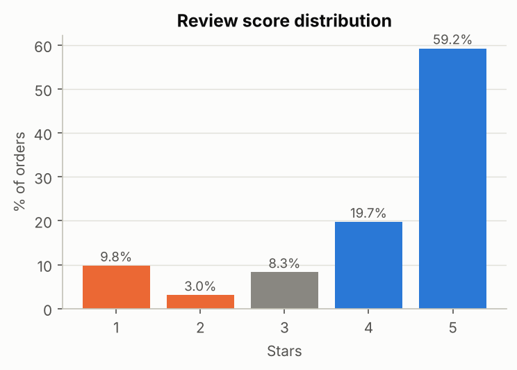

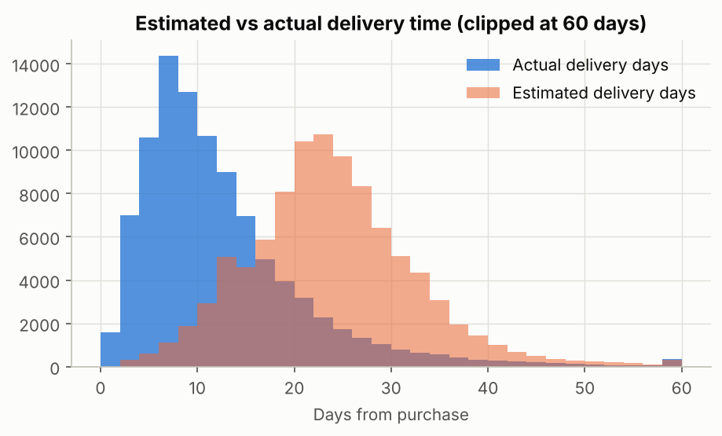

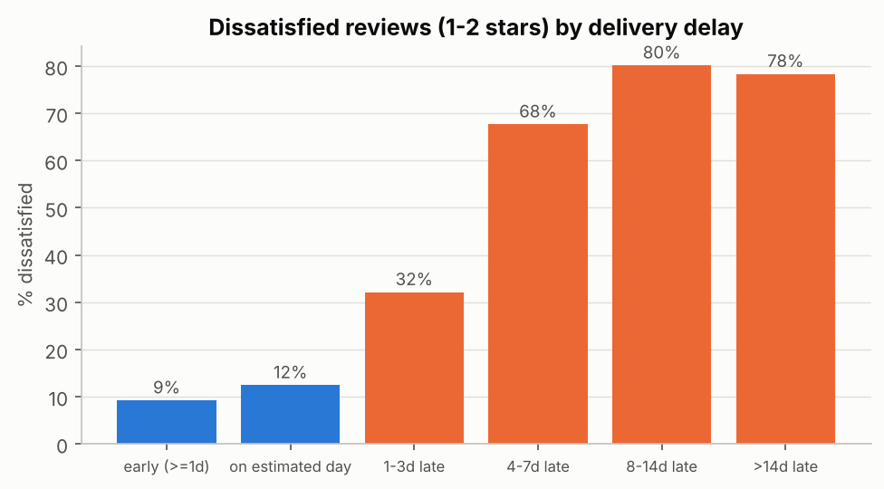

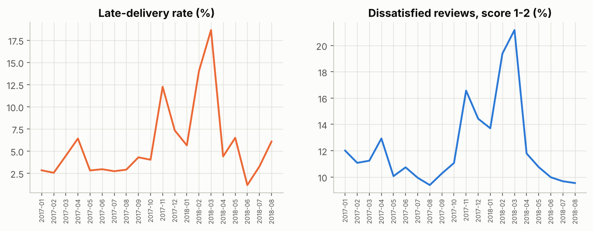

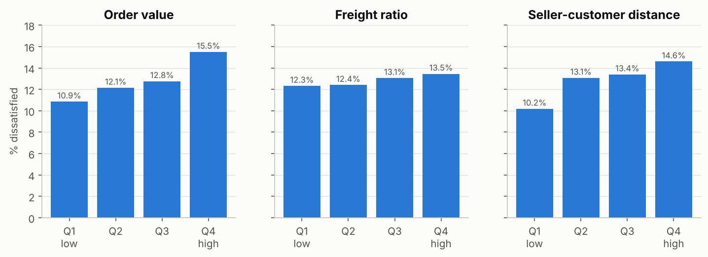

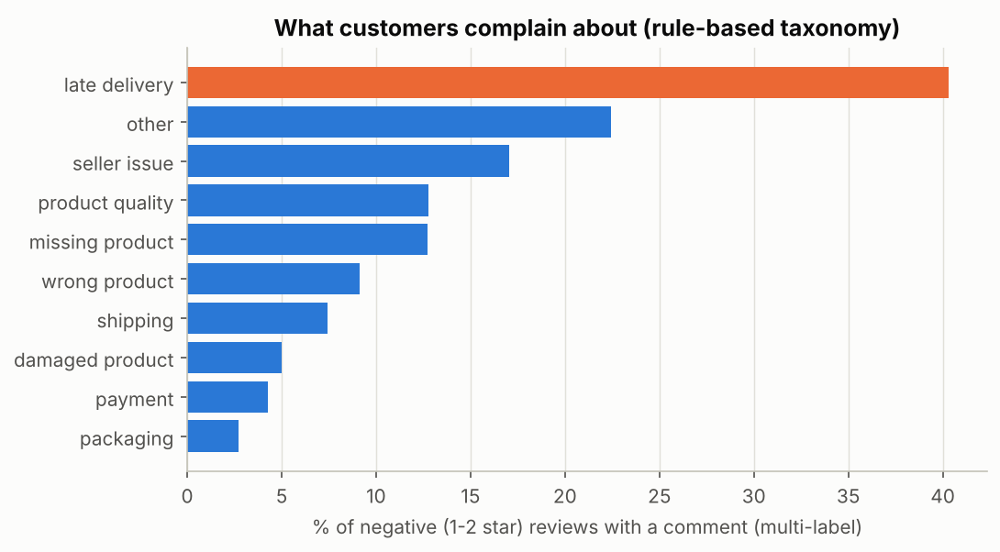

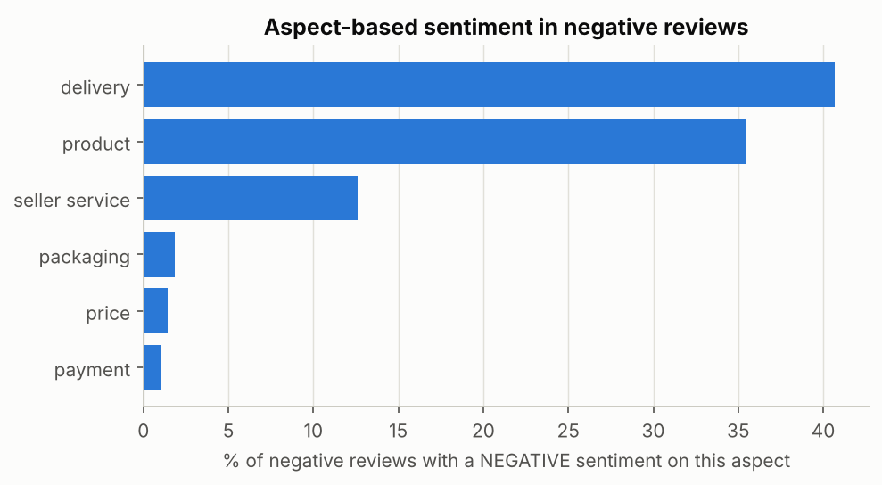

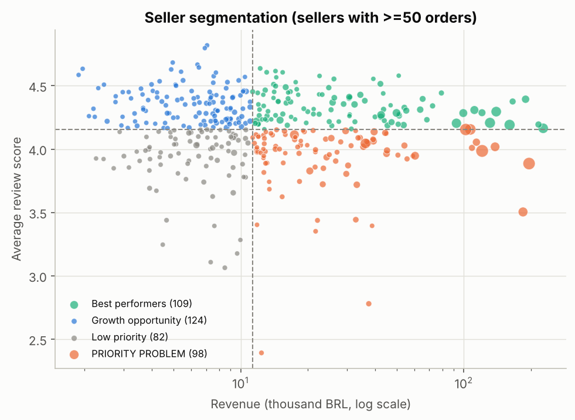

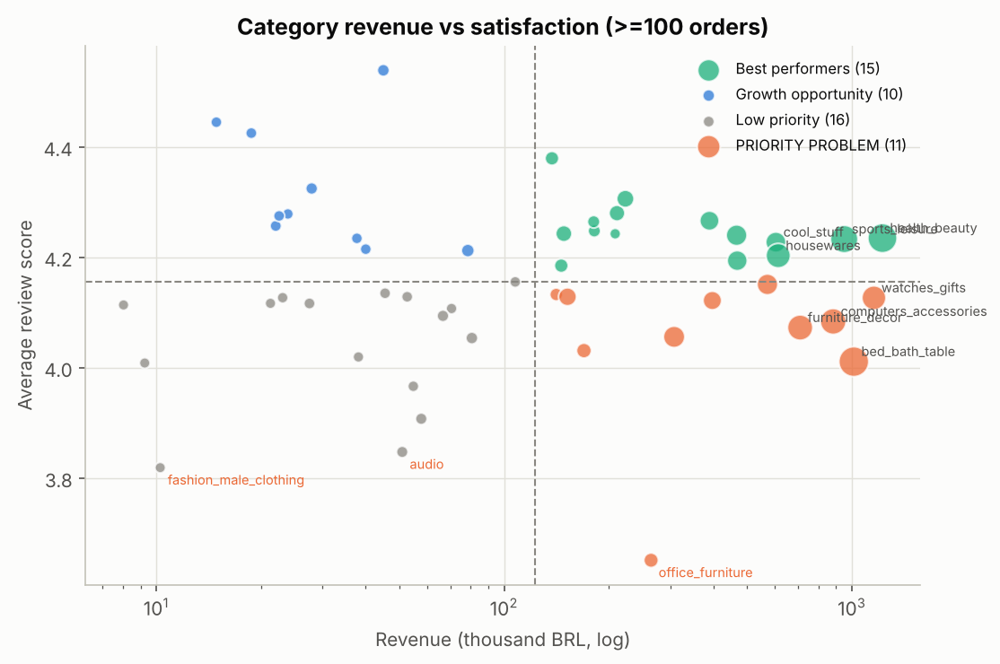

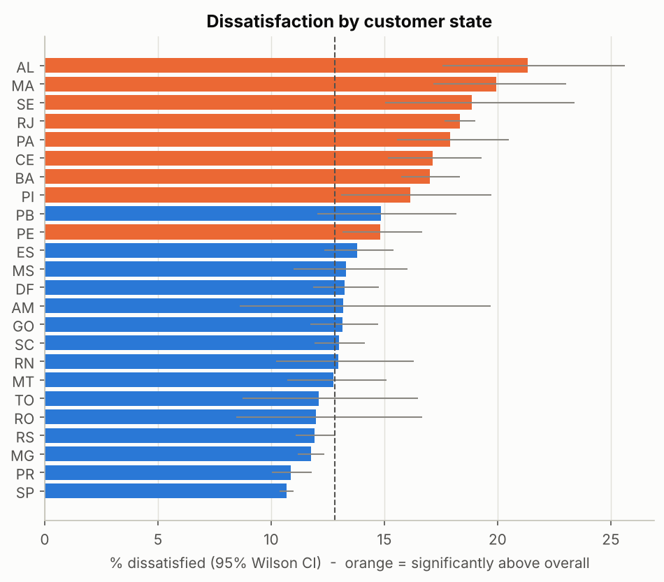

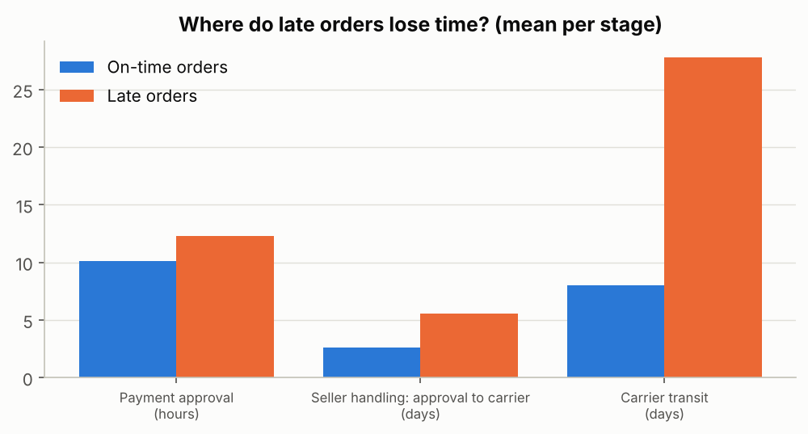

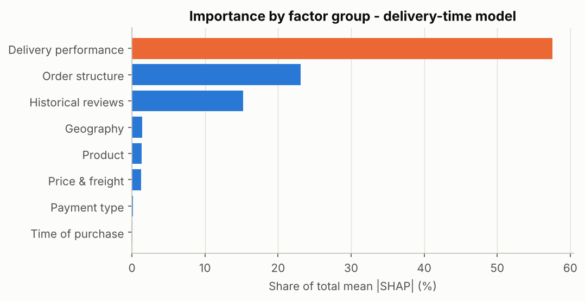

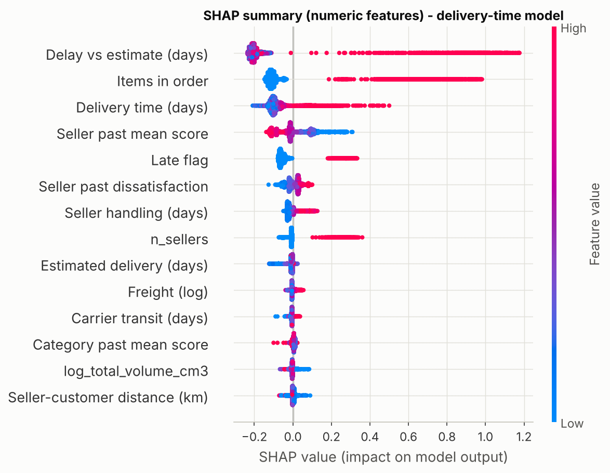

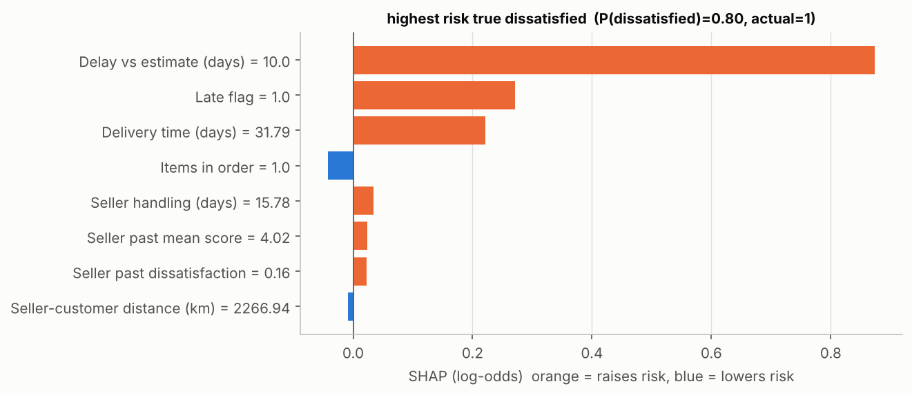
